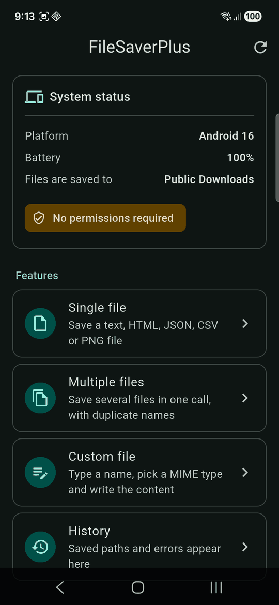
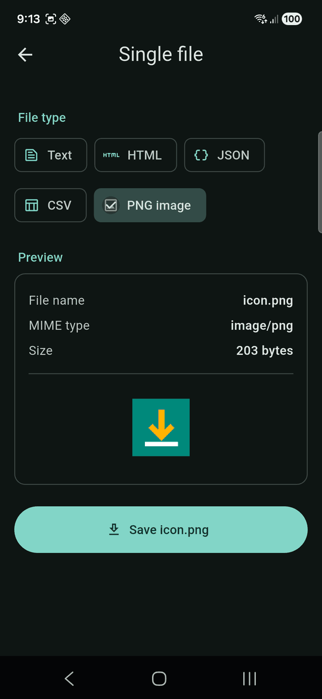
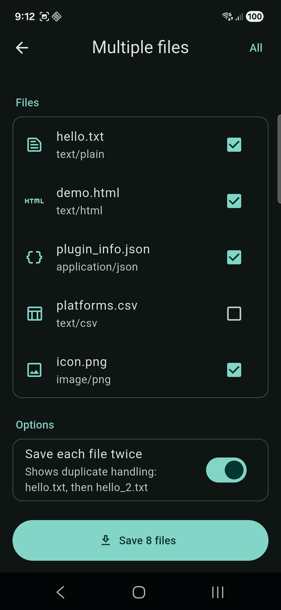
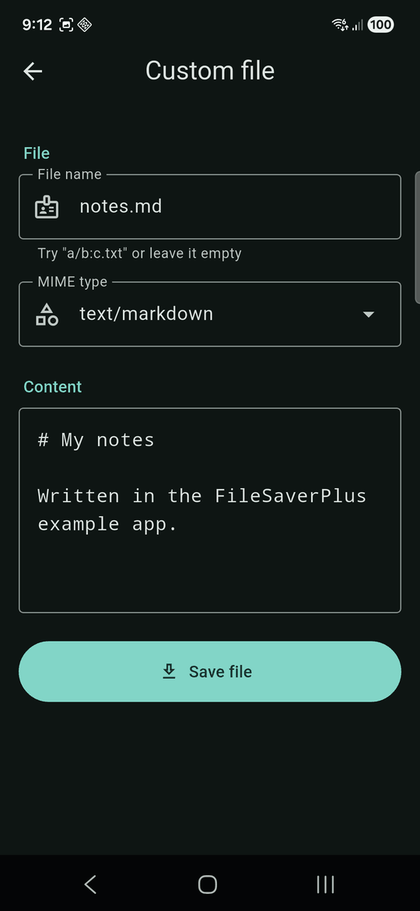

# filesaverplus

[](https://pub.dev/packages/filesaverplus)
[](https://pub.dev/packages/filesaverplus/score)
[](LICENSE)
[](#platform-support)

Save files to the user's device from Flutter on Android, iOS, macOS, Web, Windows and Linux.
One call saves one or several files. **No permissions are needed on any platform.**

Pass the bytes, a file name and a MIME type. The plugin picks the right mechanism on each
platform: MediaStore Downloads on Android, the share sheet on iOS, a save panel on macOS, a
browser download on the web, and the Downloads folder on desktop.

<p align="center">
  
  
  
  
</p>

## Install

```yaml
dependencies:
  filesaverplus: ^1.1.0
```

```dart
import 'package:filesaverplus/filesaverplus.dart';
```

**Android: no permissions.** The plugin's manifest is empty, so nothing is merged into your
app and the user never sees a permission dialog:

| Android version | Where files go | Permission |
|---|---|---|
| 10+ (API 29+) | Public **Downloads** folder, via MediaStore | none |
| 7.0–9 (API 24–28) | App-specific folder `Android/data/<package>/files/Download` | none |

On Android 7–9, writing to the *public* Downloads folder needs `WRITE_EXTERNAL_STORAGE`, so the
plugin uses the app-specific folder instead. Those files are visible in file managers and over
USB, but they are removed when the app is uninstalled.
[more](#good-to-know)

**iOS:** nothing to add. Files are handed to the system share sheet, where the user picks
*Save to Files* or any other destination, so no `Info.plist` keys are needed.

**macOS:** sandboxed apps (the `flutter create` default) need this entitlement in
`macos/Runner/DebugProfile.entitlements` and `Release.entitlements`. Without it, the save
panel opens but every write fails:

```xml
<key>com.apple.security.files.user-selected.read-write</key>
<true/>
```

**Web, Windows, Linux:** nothing to set up.

Needs **Flutter 3.50+**, **Android 7.0+ (API 24)**, **iOS 16+** or **macOS 12+**.

**iOS and macOS need Swift Package Manager.** There's no CocoaPods podspec. Other plugins in your
app can still use CocoaPods. If SPM is off in your Flutter setup, turn it on with
`flutter config --enable-swift-package-manager`.

Set your app's iOS deployment target to 16.0 in Xcode
(Runner → General → Minimum Deployments). If a build fails with *"requires minimum platform
version 16.0 … but this target supports 15.0"* even though you already did, run the build again or
run `flutter clean`. Flutter's build tool can reset its generated plugin package to iOS 15.0 when
your dependencies have just changed, and the next build sets it back to 16.0.

## Quick start

**1. Save a file.** You get back where it went:

```dart
final saver = FileSaverPlus();

final path = await saver.saveFile(
  utf8.encode('Hello!'),
  'hello.txt',
  'text/plain',
);
```

**2. Save several at once:**

```dart
final paths = await saver.saveMultipleFiles(
  dataList: [pdfBytes, csvBytes],
  fileNameList: ['report.pdf', 'data.csv'],
  mimeTypeList: ['application/pdf', 'text/csv'],
);
```

**3. Handle failures.** Bad input throws `ArgumentError`, and native failures throw
`PlatformException`:

```dart
try {
  await saver.saveFile(bytes, 'report.pdf', 'application/pdf');
} on ArgumentError catch (e) {
  print('Bad input: ${e.message}');
} on PlatformException catch (e) {
  print('Save failed [${e.code}]: ${e.message}');
}
```

## Features

| Group | Features |
|---|---|
| [Saving](#saving) | [Save one file](#save-one-file) · [Save several](#save-several-files) · [Duplicate names](#duplicate-and-unsafe-names) |
| [Results](#where-files-go) | [Where files go](#where-files-go) · [Platform info](#platform-info) |
| [Errors](#errors) | `ArgumentError` for bad input, `PlatformException` codes for native failures |

---

## Saving

### Save one file

Pass the bytes, a file name with its extension, and the MIME type.

```dart
final path = await saver.saveFile(
  Uint8List.fromList(utf8.encode('<h1>Hello</h1>')),
  'hello.html',
  'text/html',
);
print(path); // content://media/external/downloads/42 on Android 10+
```

[example](example/lib/pages/single_file_page.dart)

### Save several files

One call, one result per file, in the same order. On iOS all the files go into a single share
sheet. On macOS the user sees one save panel per file.

```dart
final paths = await saver.saveMultipleFiles(
  dataList: [
    Uint8List.fromList(utf8.encode('Summary')),
    Uint8List.fromList(utf8.encode('{"ok": true}')),
  ],
  fileNameList: ['summary.txt', 'result.json'],
  mimeTypeList: ['text/plain', 'application/json'],
);
```

[example](example/lib/pages/multiple_files_page.dart)

### Duplicate and unsafe names

Names are cleaned on every platform before anything is written:

- **Unsafe characters are replaced:** `/ \ : * ? " < > |` and control characters become `_`. An
  empty name becomes `file`.
- **Duplicates within one call are renamed:** `data.txt`, `data_2.txt`, `data_3.txt`.
- **Existing files are kept:** on Android 7–9, Windows and Linux, if `report.pdf` already exists
  the new file is saved as `report (1).pdf`. On Android 10+, MediaStore picks the new name itself.

```dart
await saver.saveMultipleFiles(
  dataList: [a, b, c],
  fileNameList: ['data.txt', 'data.txt', 'data.txt'],
  mimeTypeList: ['text/plain', 'text/plain', 'text/plain'],
); // → data.txt, data_2.txt, data_3.txt
```

[example](example/lib/pages/custom_file_page.dart): try `a/b:c.txt` or an empty name.

---

## Where files go

Each returned entry depends on the platform:

| Platform | Saved to | Returned value |
|---|---|---|
| Android 10+ | Public Downloads (MediaStore) | `content://media/external/downloads/<id>` |
| Android 7–9 | `Android/data/<package>/files/Download` | Absolute file path |
| iOS | Wherever the user picks in the share sheet | Temporary staging path |
| macOS | Wherever the user picks in `NSSavePanel` | Chosen path, or `cancelled:<fileName>` |
| Web | The browser's download folder | `download_triggered:<fileName>` |
| Windows / Linux | The user's Downloads folder | Absolute file path |

### Platform info

Two small helpers, handy for logs and support screens:

```dart
print(await saver.platformVersion);   // "Android 14", "iOS 18.2", "macOS 15.1", "Web"
print(await saver.batteryPercentage); // 0–100 on Android and iOS, null elsewhere
```

---

## Errors

`ArgumentError` is thrown before anything is written when:

- `dataList`, `fileNameList` and `mimeTypeList` have different lengths
- any `dataList` entry is empty
- any MIME type is empty

Native failures come back as a `PlatformException` with one of these codes:

| Code | Platform | Meaning |
|---|---|---|
| `INVALID_ARGUMENTS` | Android, iOS, macOS | The native side got missing or mismatched lists. |
| `WRITE_FAILED` | Android | A file couldn't be written. `message` names the file; `details` lists the paths saved before it. |
| `FILE_WRITE_ERROR` | iOS, macOS | A file couldn't be written to disk. |
| `VIEW_CONTROLLER_ERROR` | iOS | No view controller was available to present the share sheet. |
| `UNAVAILABLE` | Android, iOS | `batteryPercentage` couldn't be read. |

## Platform support

| | Android | iOS | macOS | Web | Windows | Linux |
|---|---|---|---|---|---|---|
| Save one / several files | ✅ | ✅ share sheet | ✅ save panel | ✅ download | ✅ | ✅ |
| Name cleaning & de-duplication | ✅ | ✅ | ✅ | ✅ | ✅ | ✅ |
| Never overwrites existing files | ✅ | user decides | user decides | browser decides | ✅ | ✅ |
| Permissions needed | none | none | entitlement | none | none | none |
| `platformVersion` | ✅ | ✅ | ✅ | ✅ | ✅ | ✅ |
| `batteryPercentage` | ✅ | ✅ | `null` | `null` | `null` | `null` |
| Minimum | Android 7.0 (API 24) | iOS 16 | macOS 12 | — | — | — |

## Good to know

- **Android 7–9 files live in the app's own folder.** They're visible in file managers and over
  USB, but they're removed when the app is uninstalled. If you need the public Downloads folder
  on those versions, declare and request `WRITE_EXTERNAL_STORAGE` in your app and write the file
  yourself. This plugin deliberately never asks for permissions.
- **On Android 10+ you get a `content://` URI, not a file path.** Open it with a
  `ContentResolver`-based package; `dart:io` `File` can't read it.
- **On iOS the returned path is temporary.** The staged copy is deleted when the share sheet
  closes, and the user may also cancel the sheet. Don't read from the path afterwards.
- **On the web, a result only means the download was started.** The browser decides where the
  file goes, and some browsers ask before allowing several downloads at once.
- **On macOS each file opens its own save panel.** A cancelled panel is reported as
  `cancelled:<fileName>` and the remaining files continue.

## What's new in 1.1.0

- **No permissions anywhere.** The Android runtime permission prompt is gone.
- **Android 7.0+:** the minimum Android version dropped from 9 to 7.
- **Ready for Flutter 3.50:** AGP 9.3.1, Kotlin 2.4.20, Gradle 9.5.0, and the Kotlin plugin is
  only applied when it's needed.
- **iOS/macOS: Swift Package Manager only.** The CocoaPods podspecs are gone.
- **Smoother and safer:** Android writes off the UI thread, existing files are never
  overwritten, names are cleaned on every platform, and the iOS share sheet works on top of
  other modals.
- **Material 3 example app** with light and dark themes and a new icon.
- No changes to the Dart API.

See [CHANGELOG.md](CHANGELOG.md) for everything.

## Example app

[`example/`](example) has a home page with the platform status and where files go, then one page
each for saving a single file (text, HTML, JSON, CSV or PNG), saving several files at once, building
a custom file, and the history of every save. To run it: `cd example && flutter run`.

## Learn more

- [CHANGELOG.md](CHANGELOG.md)
- [API reference on pub.dev](https://pub.dev/documentation/filesaverplus/latest/)

## Contributing

Issues and pull requests are welcome on
[GitHub](https://github.com/devamitkumartiwari/filesaverplus/issues). Please run
`flutter analyze` and `cd example && flutter test` before opening a pull request.
For support or business inquiries, see the [web portal](https://hireamit.web.app/).

## License

MIT. See [LICENSE](LICENSE).
